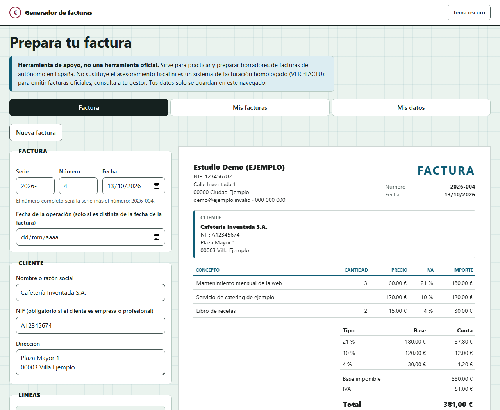

# Generador de facturas

Un generador de facturas para **autónomos en España**: rellenas tus datos y los del cliente, añades las líneas, y la página calcula la base, el IVA por tipos y la retención de IRPF. La factura se ve como una hoja A4 y se descarga en **PDF**. Todo ocurre en el navegador: lo que escribes no se envía a ningún sitio.

**Demo:** https://danimartin03.github.io/generador-facturas



> **Es una herramienta de apoyo, no una herramienta oficial.** No sustituye el asesoramiento de un gestor y **no cumple VERI\*FACTU**, el sistema de facturación homologado que la Agencia Tributaria exigirá a los autónomos (con fecha límite el 1 de julio de 2027, aunque puede haber prórrogas y conviene consultar la web de la AEAT). Sirve para practicar y para preparar borradores. Para emitir facturas oficiales, consulta a tu gestor.

## Qué hace

- **Emisor y cliente**, con NIF, dirección, y para el emisor correo, teléfono, IBAN y **logo** (PNG, JPG o WebP de hasta 1 MB, que se reduce a unos 400 px).
- **Numeración correlativa**: la serie por defecto es el año (`2026-`) y el número lleva tres cifras (`2026-001`). Al cambiar de año vuelve a empezar en 001. Avisa si te saltas un número y **no deja guardar dos facturas con el mismo**.
- **Líneas** con concepto, cantidad (hasta 3 decimales), precio e **IVA por línea** (21 %, 10 %, 4 % o exento), con el desglose por tipo de IVA.
- **Retención de IRPF** opcional, con botones para el 7 % y el 15 %.
- **Formato español**: `1.234,56 €`, fechas `dd/mm/aaaa`, y la coma como decimal al escribir.
- **Revisión en vivo**: lista lo que falta para poder guardar (número, fecha, emisor, cliente, al menos una línea) y avisa de lo que solo conviene mirar, como un NIF que no valida o un cliente sin NIF.
- **PDF** con la impresión del navegador, en tamaño A4 y con el nombre `Factura 2026-001`.
- **Mis facturas**: guarda, abre, duplica y borra. Cada factura guarda los datos del emisor tal como estaban al guardarla.
- **Copia de seguridad**: exportar e importar todo en un archivo JSON.
- **Datos de ejemplo** (todo ficticio) y un botón para **borrar todos mis datos**.
- Tema claro y oscuro.

## Privacidad

Nada sale del navegador y la página no hace ninguna petición a otros sitios: ni fuentes, ni librerías, ni estadísticas. Todo se guarda en `localStorage`, es decir, **en este navegador y en este equipo**. Si borras los datos del sitio o cambias de navegador, se pierden: por eso existe el botón de exportar.

## Cómo calcula

Las cuentas con decimales en JavaScript se desvían (`0.1 + 0.2` no es `0.3`), así que **no uso decimales**: el dinero va en céntimos, las cantidades en milésimas y el IRPF en centésimas de punto, todo con números enteros. Las reglas de redondeo son estas:

- Cada línea se redondea al céntimo (`cantidad × precio`).
- El IVA se calcula **una vez por cada tipo**, sobre la suma de las bases de ese tipo, y no línea a línea.
- La retención se calcula **una vez sobre la base imponible total**.

Los límites mantienen todas las operaciones por debajo de `Number.MAX_SAFE_INTEGER`. Para comprobarlo comparé 300.000 facturas generadas al azar con un cálculo exacto hecho con `BigInt`, y el resultado fue idéntico.

La validación del NIF (DNI, NIE y CIF) es solo un **aviso**: un NIF que no valida no impide guardar, porque puede ser un documento extranjero o un error mío de interpretación.

## Cómo se genera el PDF

No uso ninguna librería de PDF. La página tiene una segunda copia de la factura (`#hojaImpresa`) que está oculta en pantalla y, al imprimir, es lo único que se ve. Con `@page { size: A4 }` el navegador la reparte en páginas, repite la cabecera de la tabla y evita partir las filas. Antes de imprimir cambio el título de la página a `Factura 2026-001`, que el navegador propone como nombre del archivo.

En el cuadro de imprimir hay que elegir **Guardar como PDF** y desmarcar **Encabezados y pies de página** si el navegador los pone. La página lo explica junto al botón.

## Fuentes

- [Real Decreto 1619/2012](https://www.boe.es/buscar/act.php?id=BOE-A-2012-14696), reglamento de facturación (BOE): contenido obligatorio de la factura. El NIF del destinatario solo es obligatorio en algunos casos, por eso en la página es un aviso y no un requisito.
- [VERI\*FACTU](https://sede.agenciatributaria.gob.es/Sede/iva/sistemas-informaticos-facturacion-verifactu.html), Agencia Tributaria.
- [Tipos de retención](https://sede.agenciatributaria.gob.es/Sede/ayuda/manuales-videos-folletos/manuales-practicos/folleto-actividades-economicas/7-otras-obligaciones-fiscales-retenciones/7_1-cuadro-relacion-tipos-retencion-porcentaje.html), Agencia Tributaria. El 15 % es el general para profesionales y el 7 % es el reducido para los nuevos profesionales en el año de inicio y los dos siguientes.

Los datos legales cambian. Antes de usar esto para algo real, comprueba las fuentes.

## Qué he aprendido

<!-- TODO: repasar esta lista y dejarla con mis palabras -->

- Por qué no se calcula dinero con decimales y cómo hacerlo con enteros, incluido el redondeo y el orden en que se redondea.
- A escribir y leer números en formato español sin depender de `toLocaleString`, que no pone el punto de los miles en los números de cuatro cifras.
- A validar un DNI, un NIE y un CIF con sus dígitos de control.
- A generar un PDF con CSS de impresión: `@page`, saltos de página, repetir la cabecera de una tabla y los colores al imprimir.
- A tratar los datos guardados como no fiables: valido cada campo al cargarlos y al importar, y guardo una copia si encuentro algo dañado.
- A no confiar en un archivo del usuario: el logo solo entra si es PNG, JPG o WebP, nunca SVG, y todo lo que se escribe se pinta con `textContent`.
- A avisar antes de perder datos: confirmaciones al sustituir o borrar y un aviso al cerrar la pestaña con cambios sin guardar.
- A comprobar de verdad: probé la página en varios anchos con un navegador controlado por código, generé PDFs reales y los leí para medir los márgenes.

## Tecnologías

- HTML, CSS y JavaScript sin frameworks, sin librerías y sin proceso de compilación.
- `localStorage`, `FileReader`, `canvas` (para reducir el logo), `Blob` para descargar el JSON, `<dialog>` y CSS de impresión.

## Cómo ejecutarlo en local

No hace falta instalar nada. Vale con descargar el repositorio y abrir `index.html` en el navegador.

Si prefieres un servidor local, con Python:

```bash
python -m http.server 5560
```

Y después abre http://localhost:5560.

## Estructura

```
index.html          Formulario, vista previa de la factura, listado y datos
css/estilos.css     Estilos (móvil primero, tema claro y oscuro, impresión)
js/dinero.js        Leer y escribir importes, cantidades y fechas en formato español
js/calculos.js      Líneas, IVA por tipos, retención y límites (no toca la página)
js/nif.js           Validación de DNI, NIE y CIF (no toca la página)
js/datos.js         Guardar, validar, numerar, exportar e importar (no toca la página)
js/ejemplo.js       Datos de ejemplo ficticios
js/factura.js       Dibujar la hoja de la factura
js/app.js           Formulario, pestañas, guardado, logo y PDF
```

## Límites que conozco

- **No es una factura electrónica ni cumple VERI\*FACTU.** No firma, no encadena registros ni envía nada a Hacienda.
- No hace facturas rectificativas, simplificadas (tickets), con recargo de equivalencia, con IVA de otros países ni en otras monedas.
- Los límites son: 50 líneas por factura, cantidad hasta 10.000, precio hasta 1.000.000 €, importe por línea hasta 100.000.000 €, IRPF hasta el 50 % y 500 facturas guardadas.
- Los datos viven en un solo navegador. No hay cuenta ni sincronización entre equipos.
- Al importar una copia se **sustituye todo** lo que hay; no se mezclan.
- El PDF depende del cuadro de imprimir de cada navegador. Lo probé generándolo con Edge, pero no en el cuadro de imprimir de otros navegadores ni en móviles.
- No he podido probarlo en Safari ni en Firefox, ni en un móvil real.

## Mejoras que haría

- Facturas rectificativas y simplificadas.
- Recargo de equivalencia y otros regímenes de IVA.
- Un listado de clientes guardados para no escribirlos cada vez.
- Un informe trimestral con las bases, el IVA y las retenciones, para el gestor.
- Generar el PDF sin pasar por el cuadro de imprimir.
- Pruebas automáticas dentro del repositorio para `calculos.js`, `dinero.js` y `nif.js`.

## Licencia

[MIT](LICENSE) © Daniel Martín Pérez
